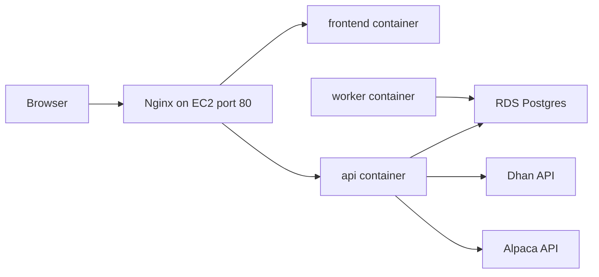

# AWS stack: EC2 + RDS + Terraform (v1)

Verbose execution plan for the first AWS deploy of this monorepo. Follow-up hardening (including public HTTPS/domain) is tracked separately in [`docs/aws-ec2-hardening-followup.md`](docs/aws-ec2-hardening-followup.md) — do not expand that work into v1.

## Overview / target architecture

One EC2 instance in the **default VPC** in **`ap-south-1`**, with a stable **Elastic IP**. On that instance, Docker Compose runs:

- `api` — FastAPI / uvicorn (existing [`backend/Dockerfile`](backend/Dockerfile) + [`backend/docker-entrypoint.sh`](backend/docker-entrypoint.sh))
- `worker` — same image, `supercronic` + [`backend/crontab`](backend/crontab)
- `frontend` — Next.js 15 (new `frontend/Dockerfile`; not Vercel for this path)
- `nginx` — reverse proxy on host port **80**

**RDS PostgreSQL 16** lives in the same VPC, **`publicly_accessible = false`**, security group allows **5432 only from the EC2 security group**.



Traffic path: browser → `http://<ElasticIP>/` → Nginx → frontend (`:3000`) or API (`:8000`).

**Provisioning order:** Terraform + AWS CLI create/change infrastructure. **AWS MCP is not used to create resources**; after a successful apply it may be used read-only to inspect what Terraform created. App code rolls out through `deploy/deploy.sh`, not through Terraform.

**Repo pieces this plan adds/changes:**

- `infra/terraform/` — Terraform root module
- `docker-compose.aws.yml` — AWS Compose file (no local Postgres)
- `deploy/nginx.conf`, `deploy/deploy.sh`
- `frontend/Dockerfile` (+ `output: "standalone"` in Next config if required)
- Delete [`render.yaml`](render.yaml); update [`README.md`](README.md) Deploy section

Local [`docker-compose.yml`](docker-compose.yml) stays for laptop use (Postgres + bind mounts).

## Prerequisites

Before writing or applying Terraform:

1. **AWS account** with an IAM user or SSO profile that can manage EC2, EIP, RDS, security groups, and key pairs in `ap-south-1`.
2. **AWS CLI** configured for that profile. Confirm with `aws sts get-caller-identity` and that the default/selected region is `ap-south-1` (or pass `-var=region=ap-south-1` consistently).
3. **Terraform CLI** installed and **pinned** to the same major/minor as `required_version` in `infra/terraform/versions.tf` (install via Homebrew or `tfenv`). Exact pin is chosen when scaffolding and recorded in the module + committed lockfile.
4. **Existing SSH keypair** on your laptop (e.g. `~/.ssh/id_ed25519` + `.pub`). Terraform will register **only the public key** as `aws_key_pair`. Do **not** generate a private key with the `tls` provider into Terraform state.
5. Your current **public IP / CIDR** for SSH ingress (`admin_cidr`, e.g. `x.x.x.x/32`). If the IP changes later, update the variable and re-apply.
6. **Secrets on hand** for the app `.env` and RDS: `DHAN_CLIENT_ID`, `DHAN_PIN`, `DHAN_TOTP_SECRET`, optional `DHAN_ACCESS_TOKEN`, `ALPACA_API_KEY`, `ALPACA_SECRET_KEY`, `US_MARKET_ENABLED`, and a chosen RDS master password.
7. Optional locally: Docker (to test image builds before first deploy). On EC2, deploy needs git access to this repo (HTTPS token or deploy key) unless you scp a release tarball instead.

## Terraform (`infra/terraform/`)

### Layout

Suggested files:

- `versions.tf` — `required_version`, `required_providers`
- `providers.tf` — AWS provider (`region` variable, default `ap-south-1`)
- `variables.tf` / `outputs.tf`
- `main.tf` or split: `network.tf`, `ec2.tf`, `rds.tf`
- `user_data.sh.tftpl` — cloud-init / shell template
- `terraform.tfvars.example` — placeholders only
- `.terraform.lock.hcl` — **commit this**
- Local only (gitignored): `terraform.tfvars`, `.terraform/`, `*.tfstate*`

### Version pinning

- Set `required_version` to a pinned Terraform constraint (e.g. `~> 1.9`).
- Pin `hashicorp/aws` provider (e.g. `~> 5.0`).
- After `terraform init`, **commit `.terraform.lock.hcl`**.
- Ensure [`.gitignore`](.gitignore) ignores `.terraform/`, `*.tfstate`, `*.tfstate.*`, and `terraform.tfvars`, but **does not** ignore the lockfile.

### Resources (exact set for v1)

**Data sources**

- Default VPC (`aws_vpc` filter `default = true`)
- Subnets in that VPC (`aws_subnets`)
- Latest suitable AMI (Ubuntu 24.04 LTS x86_64 or Amazon Linux 2023 — pick one and stick to it) via `aws_ami` with owner + name filters, `most_recent = true`

**Networking / access**

- `aws_security_group.ec2`
  - Ingress TCP **22** from `var.admin_cidr`
  - Ingress TCP **80** from `0.0.0.0/0` (and `::/0` if you enable IPv6)
  - Egress all (needed for Dhan/Alpaca, apt, git, ECR later)
- `aws_security_group.rds`
  - Ingress TCP **5432** **only** from `aws_security_group.ec2.id`
- `aws_key_pair` — `public_key = file(var.ssh_public_key_path)` (existing laptop pubkey; never `tls_private_key` for this)

**Compute**

- `aws_instance.app`
  - Instance type: prefer **`t3.small`** (or `t4g.small` if on ARM AMI) so Next.js builds are less likely to OOM; document that `t3.micro` needs swap and may still fail builds
  - Attach EC2 SG + key pair
  - Root volume: **gp3**, ~20–30 GB
  - `user_data` = rendered `user_data.sh.tftpl`
  - **`lifecycle { ignore_changes = [ami] }`** so a newer matching AMI in the data source does **not** force instance replacement on every plan. Do **not** ignore `user_data` in v1 if you want template edits to show in plan — but understand that changing `user_data` without ignore **replaces the instance**. Prefer: treat user_data as first-boot only and put ongoing changes in `deploy.sh`; if you later edit the template and want to avoid replacement, add `user_data` to `ignore_changes` and document that new instances only get the new bootstrap.
- `aws_eip` + `aws_eip_association` for a stable public IPv4

**Database**

- `aws_db_subnet_group` using default-VPC subnets
- `aws_db_instance`
  - Engine **Postgres 16**
  - Class e.g. **`db.t4g.micro`** (or `db.t3.micro` if ARM unavailable in account/region)
  - Allocated storage ~20 GB gp3
  - `db_name = "signals"` (or match app expectation)
  - Master username/password from variables (`password` marked `sensitive = true`)
  - `publicly_accessible = false`
  - Attached RDS SG
  - v1 may use `skip_final_snapshot = true` for easy destroy while learning; production-hardening (retention, deletion protection, final snapshot) is in the follow-up doc — call that out in README so destroy surprises are expected

**Outputs**

- `eip_public_ip`
- `app_url` = `http://${eip_public_ip}`
- `rds_endpoint`, `rds_port`
- `ssh_command` hint (`ssh -i ... ubuntu@<eip>` or AL2023 `ec2-user@...`)

### Secrets and state

- Real values live in **gitignored** `terraform.tfvars` (and/or `TF_VAR_*`): `db_password`, `admin_cidr`, `ssh_public_key_path`, instance/DB sizes if overridden.
- Commit `terraform.tfvars.example` with empty placeholders and comments.
- Note once in docs: even with `sensitive = true`, the DB password is stored in **local Terraform state** in plaintext on disk — protect the state file; do not commit it.

### Commands

```bash
cd infra/terraform
terraform init
terraform fmt -recursive
terraform validate
terraform plan -out tfplan
terraform apply tfplan
```

State is **local** for v1. Remote state (S3 + lock table) is follow-up.

## EC2 bootstrap (`user_data`)

**First-boot only:** cloud-init runs `user_data` when the instance is **first created**. Editing the template later does **nothing** to an already-running instance unless Terraform **replaces** that instance. Treat this script as one-time OS setup. All app updates go through `deploy/deploy.sh`.

Intended steps in `user_data.sh.tftpl`:

1. Log to `/var/log/user-data.log` (and `set -eux` style safety).
2. Update packages.
3. Install **Docker Engine**, **Docker Compose plugin**, and **git**.
4. Enable and start `docker`; add the default login user (`ubuntu` / `ec2-user`) to the `docker` group.
5. Optionally create a **~2 GB swapfile** (helps if you ever use a smaller instance or build frontend on-box).
6. `mkdir -p /opt/neev-signals` and chown to the deploy user.

**Not** in `user_data`: cloning with secrets, writing `backend/.env`, `docker compose up`, Certbot, or Alembic. Verify after SSH: `cloud-init status --wait` and `tail -n 100 /var/log/user-data.log`.

## Responsibilities: Terraform vs user_data vs deploy.sh

| Concern | Owner |
|--------|--------|
| VPC/SG/EC2/EIP/RDS/key pair | **Terraform** |
| Docker install, `/opt/neev-signals`, swap | **user_data** (once) |
| git sync, `.env`, image build/up, health check | **deploy/deploy.sh** (repeatable) |

Do not put app release steps into Terraform `null_resource` provisioners for v1 — that couples code deploys to infra apply and is harder to iterate while learning.

## Docker Compose for AWS (`docker-compose.aws.yml`)

Compared to local [`docker-compose.yml`](docker-compose.yml):

- **No** `postgres` service — RDS only.
- **No** bind-mount of `./backend` — images are built from Dockerfiles.
- Host publish: only **Nginx `80:80`** (api/frontend stay on the Docker network).
- `restart: unless-stopped` on app services.
- `env_file` pointing at `/opt/neev-signals/backend/.env` (or compose `env_file` relative to that tree after clone).

### `api`

- Build context `./backend` (from repo root on the instance).
- `command: ["api"]` (entrypoint runs uvicorn).
- **Migrations:** keep current behavior — [`backend/docker-entrypoint.sh`](backend/docker-entrypoint.sh) runs `alembic upgrade head` when `DATABASE_URL` is set **only in the `api` branch**. Do **not** also migrate from `deploy.sh` or from `worker`. Rule: **migrations run once, at api startup.**

### `worker`

- Same image; `command: ["worker"]` → supercronic + crontab.
- `depends_on` api with health condition when practical.
- Must **never** run Alembic.

### `frontend`

- New **`frontend/Dockerfile`** (multi-stage). Add Next **`output: "standalone"`** in frontend config if not already present so the image can run `node server.js` cleanly.
- Listen on **3000** inside the network.
- **`NEXT_PUBLIC_API_URL`:** Next inlines this at **build** time. For v1, pass build arg `NEXT_PUBLIC_API_URL=http://<ElasticIP>` (no trailing slash), matching how the UI calls the API today. If we later switch the client to same-origin relative `/api/...` paths, Nginx already can route those — that would be a small frontend change; until then, bake the EIP URL at build time and rebuild frontend after EIP is known / changes.

### `nginx`

- Image `nginx:alpine` (or stable).
- Mount [`deploy/nginx.conf`](deploy/nginx.conf).
- `depends_on` api + frontend.
- Publish `80:80`.

## Nginx routing (`deploy/nginx.conf`)

Single `server` listening on **80**:

- `location /api/` (and other API prefixes the app uses) → `http://api:8000`
- `location = /health` → `http://api:8000/health` (and optionally `/docs`, `/openapi.json` if you want them public)
- `location /` → `http://frontend:3000`

Set `proxy_set_header Host`, `X-Real-IP`, `X-Forwarded-For`, `X-Forwarded-Proto`; raise `proxy_read_timeout` for slow signal endpoints; set a sane `client_max_body_size`.

Smoke checks after deploy: `curl -fsS http://<EIP>/health`, hit a meta API route, open the UI in a browser.

## Environment variables (on EC2)

File: **`/opt/neev-signals/backend/.env`** (mode ideally `600`; never commit). Create on first deploy (scp or `deploy.sh` from a local gitignored source).

| Variable | Notes |
|----------|--------|
| `DHAN_CLIENT_ID` | Required for IN market |
| `DHAN_PIN` | 6-digit PIN |
| `DHAN_TOTP_SECRET` | TOTP from Dhan web |
| `DHAN_ACCESS_TOKEN` | Optional bootstrap |
| `ALPACA_API_KEY` / `ALPACA_SECRET_KEY` | US market |
| `ALPACA_TRADING_BASE` | Optional |
| `US_MARKET_ENABLED` | `true` / `false` |
| `CORS_ORIGINS` | `http://<ElasticIP>` (and any extra origins you need) |
| `DATABASE_URL` | See below |

**`DATABASE_URL` (required form):**

```text
postgresql+psycopg://<user>:<password>@<rds_endpoint>:5432/signals?sslmode=require
```

URL-encode special characters in the password. `sslmode=require` is mandatory for RDS. Assert this string in `deploy.sh` before `compose up`.

Frontend build arg (compose/build): `NEXT_PUBLIC_API_URL=http://<ElasticIP>`.

Keep [`backend/.env.example`](backend/.env.example) updated with a commented RDS-style URL example including `sslmode=require`.

## Deploy script (`deploy/deploy.sh`)

Runs **on the instance** (after SSH), repeatable:

1. `cd /opt/neev-signals` (first deploy: `git clone` into this path if empty).
2. `git fetch` + checkout/reset to the release branch.
3. Assert `backend/.env` exists and `DATABASE_URL` contains `sslmode=require`.
4. `docker compose -f docker-compose.aws.yml build` (pass EIP build arg for frontend).
5. `docker compose -f docker-compose.aws.yml up -d`.
6. Wait for `curl -fsS http://127.0.0.1/health` (via Nginx).
7. On failure, print `docker compose ps` and recent logs.

Migrations: **do not** add a separate `alembic upgrade` in this script while the api entrypoint already migrates — avoid double-migrate races.

Optional one-shot job (existing entrypoint mode):  
`docker compose -f docker-compose.aws.yml run --rm api job -- --market ALL` (match current CLI flags).

A thin laptop wrapper `scripts/aws-deploy.sh` may SSH and invoke `deploy/deploy.sh`; optional.

## Remove Render

- Delete [`render.yaml`](render.yaml).
- Update [`README.md`](README.md): remove structure bullet and “API — Render” / “Render API URL” wording; replace Deploy with AWS Terraform + deploy script instructions.
- No application code depends on Render beyond that config file.

## AWS MCP (after apply only)

1. Complete `terraform apply` and a successful first deploy with CLI/SSH.
2. Then connect AWS MCP in Cursor (workspace MCP config is currently empty).
3. Use MCP **read-only** to confirm instance state, RDS status, security group rules, and to spot drift vs Terraform.
4. **Never** create/modify/delete infra via MCP while this stack is Terraform-managed — that causes drift. Fix drift by changing `.tf` and re-applying.

Prefer a read-only IAM policy for the MCP credentials if you split keys.

## Verification checklist

- [ ] `terraform output` shows EIP, app URL, RDS endpoint
- [ ] `cloud-init status` finished; user-data log clean
- [ ] `docker compose -f docker-compose.aws.yml ps` — api, worker, frontend, nginx healthy/up
- [ ] `curl http://<EIP>/health` → ok
- [ ] UI loads and can call API
- [ ] Worker logs show supercronic schedules
- [ ] Inside api container: Alembic at head
- [ ] Optional: on RDS, session shows SSL in use

## Teardown / cost notes

- `terraform destroy` removes EC2/EIP/RDS/SGs created by this module. With v1 `skip_final_snapshot = true`, RDS data is **gone** on destroy — expected for learning; follow-up tightens this.
- Elastic IPv4 addresses can incur charges when unattached; destroy cleanly or release EIPs.
- Rough ongoing cost is dominated by **EC2 small + RDS micro + public IPv4**; avoid adding NAT gateways.

## Out of scope (v1)

All items in [`docs/aws-ec2-hardening-followup.md`](docs/aws-ec2-hardening-followup.md): public HTTPS (domain + Certbot), SSM Session Manager, budgets, RDS backup/deletion protection, SSM Parameter Store secrets, ECR off-box builds, log rotation / recover alarms, remote Terraform state, custom private-subnet VPC, ECS/Fargate, deleting any live Render service in the Render dashboard.

## Learning focus (short)

- Terraform plan/apply/state and provider pinning
- Security group chaining (EC2 → RDS only)
- cloud-init first-boot vs repeatable deploy scripts
- Prod Compose (baked images, external DB) vs local Compose
- Nginx as the single public entrypoint for web + API
